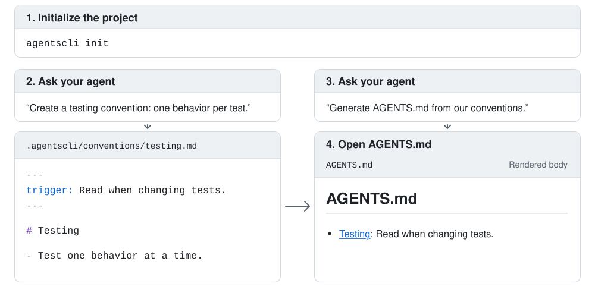

# agentscli

> A convention is a shared choice about how a team works in recurring situations, such as adopting Conventional Commits for commit messages. agentscli keeps these agreements in Markdown and generates an `AGENTS.md` index that tells coding agents when to read each one.

[npm package](https://www.npmjs.com/package/@devel-solid/agentscli) · Node.js 22, 24 or 26 · [MIT](https://github.com/devel-solid/agentscli/blob/main/LICENSE)



In this example, **Test focus** links to `.agentscli/conventions/test-focus.md`. **Read when defining test cases.** tells an agent when to consult it. The full rules stay in the convention file.

## Create your first convention and index

The steps below produce the files shown above. You need **Node.js 22, 24, or 26** and [pnpm](https://pnpm.io/installation).

If your project already has a handwritten `AGENTS.md`, read [adopting an existing project](#adopting-an-existing-project) before generating the index. Initialization preserves that file.

### 1. Install the CLI

```sh
pnpm add --global @devel-solid/agentscli
```

Run the remaining commands from your project root.

### 2. Initialize the project

Preview setup, then install the project skills:

```sh
agentscli init --dry-run
agentscli init
```

`init` creates `.agentscli/conventions/` when needed and installs three skills under `.agents/skills/`. It preserves existing conventions and `AGENTS.md`. You can repeat it to complete setup or refresh recognized resources.

### 3. Write the testing rules

Ask your agent:

> Create a test-focus convention: one behavior per test.

The agent should create **`.agentscli/conventions/test-focus.md`** with this content:

```markdown
---
trigger: Read when defining test cases.
---

# Test focus

- Test one behavior at a time.

A rejection test for an invalid name should not also assert successful file
creation. Give the success behavior its own test so either failure identifies
the behavior that regressed. Several assertions describing the same rejection
can stay together.
```

The `trigger` says when to read the file. The `# Test focus` heading supplies its title. Everything below the heading contains your project rules.

### 4. Preview, then generate the index

Ask your agent:

> Generate AGENTS.md from our conventions.

The build skill validates the conventions and generates **`AGENTS.md`** at the project root.

The result is:

```markdown
---
generatedBy: '@devel-solid/agentscli'
---

# AGENTS.md

- [Test focus](.agentscli/conventions/test-focus.md): Read when defining test cases.
```

Open `AGENTS.md` and follow the **Test focus** link. It should open the convention you created in step 3. The index carries the title and trigger; the rule itself remains in `test-focus.md`.

**Starting without conventions?** `init` prepares the empty folder and skills. Running the build skill with no conventions generates an index containing only its metadata and title.

## Update the rules as your project changes

Edit your conventions, then regenerate the index with `agentscli-build-agents`. Added conventions get new entries. Deleted conventions disappear from the next index.

For more topics, add files such as `api-errors.md` with the heading `# API errors`. Each convention requires a nonempty YAML `trigger`, one H1, and its rules. The optional `reviewedHash` and `reviewPolicyVersion` fields record completed refactoring review; omitting either keeps the convention pending. Match the filename to the title, and keep the rules self-contained, without links to other conventions or skills. Subfolders and other content languages are supported.

The [authoring reference](#authoring) covers the complete format and naming rules.

## Let an agent maintain the conventions

Setup installs three skills under `.agents/skills/`. Each skill gives an agent instructions and scripts for a specific task:

| Skill                            | Use it to                                                                                                                    |
| -------------------------------- | ---------------------------------------------------------------------------------------------------------------------------- |
| `agentscli-write-conventions`    | Create, review, or edit convention files                                                                                     |
| `agentscli-build-agents`         | Validate conventions, preview changes, regenerate the index, or check freshness                                              |
| `agentscli-optimize-conventions` | Select pending reviews, audit boundaries, record completion, invalidate reopened receipts, and apply approved reorganization |

For an update, ask your agent:

> Update our testing convention from the current tests, then regenerate AGENTS.md.

For a check without edits:

> Check our conventions and AGENTS.md without changing files.

The installed build skill runs offline using Node.js and versioned project resources. It needs no installed CLI, compiler, Git, or dependency installation.

`agentscli-optimize-conventions` replaces `agentscli-refactor-conventions`. Both `init` and `update` install the new skill and preserve the old tree. After installation, manually remove `.agents/skills/agentscli-refactor-conventions/` if it came from agentscli and you no longer need it. There is no alias or automatic migration.

## Refactor an existing collection

Ask your agent:

> Audit our conventions for mixed responsibilities. Show complete proposed files and a preservation mapping; do not edit yet.

The refactoring skill first runs its read-only selection script. It reviews conventions whose content/location or review criteria changed, or whose review fields are missing. It identifies independent decisions and overlapping ownership, then proposes exact target paths, titles, triggers, contents, removals, and index effects. You approve that concrete proposal before it changes agreements or file organization. Completed reviews normally record only their two metadata fields; reopening an already cached review can remove those fields to keep it pending. An explicit instruction to write no files forbids both metadata operations too. Approval of the proposal and index synchronization covers both operations without repeated per-file questions.

In the request above, "do not edit yet" also defers metadata receipt writes. The agent can show findings and metadata previews, but preserves every authored file until that restriction changes.

For example, a broad Testing file may mix fresh fixture state with fixed clocks. The plan can split it into Fixture independence and Fixed test clocks, each with its own reading condition and complete examples. It accounts for every original obligation and exception before retiring the source. A conflict such as two versus three retries for the same job requires a policy decision; refactoring must not silently choose one.

The skill can also recommend keeping a rule with its exception or consolidating duplicate ownership of the same decision. It does not maximize the number of files or create skills from displaced procedures without authorization.

An invalid baseline does not prevent diagnosis. The proposal identifies any necessary mechanical repair as its first phase. After approval, the authoring agent applies only that repair, repeats strict validation, and then continues the approved reorganization. For example, a valid Test focus document in `wrong-name.md` is renamed to `test-focus.md` with its bytes preserved. A collision or an unknown trigger remains an unresolved decision; the checker never invents values or repairs files automatically. Invalid or still-unresolved conventions receive no completed review receipt.

### Select, record, and invalidate review state

The convention frontmatter may contain:

| Field                 | Meaning                                                                            |
| --------------------- | ---------------------------------------------------------------------------------- |
| `reviewedHash`        | The 64-character lowercase SHA-256 digest for the exact reviewed path and content. |
| `reviewPolicyVersion` | The positive decimal string identifying the criteria used, initially `'1'`.        |

Both fields are optional. A convention is selected when either is absent, the hash differs, or the stored version differs from the current review policy. A matching receipt allows a repeated standalone review to be skipped. It does not certify correctness or compatibility with future conventions. The full title/trigger inventory remains available; the agent can read skipped bodies to detect overlap or conflict with a new candidate.

The refactoring skill owns its private script. Discover that skill's actual project location and run:

```sh
node <refactor-skill>/scripts/review-conventions.mjs select --repo-root <project> --json
```

Selection writes nothing. After completing semantic review of a surviving convention, use its returned hash to record completion:

```sh
node <refactor-skill>/scripts/review-conventions.mjs record --repo-root <project> --path <relative-convention> --expected-hash <hash-from-selection> --expected-policy-version <policy-version-from-selection> --dry-run --json
node <refactor-skill>/scripts/review-conventions.mjs record --repo-root <project> --path <relative-convention> --expected-hash <hash-from-selection> --expected-policy-version <policy-version-from-selection> --json
```

The dry run previews metadata-only effects. Recording requires the exact selected hash and `policyVersion`; it rejects stale hashes, changed criteria, and invalid or unsafe targets. After approved content changes, select again and review the final version before recording its final hash. A criteria upgrade between selection and recording returns STALE_REVIEW_POLICY even if the file is unchanged. Do not reuse a pre-edit hash or blindly replace either expectation after a concurrent change. Deleted source files receive no receipt, and final split/merge targets are reviewed individually. Metadata updates preserve existing BOM and LF, CRLF, or bare-CR line endings.

For example, an unchanged Fixture independence agreement can be reviewed and recorded. Adding a new exception, changing its trigger, or copying it to a different project-relative path makes it pending again. Merely opening it or preparing an unapproved split does not complete review. Leave unresolved findings pending so the next invocation does not hide unfinished work. If the user explicitly resolves the finding by retaining the agreement, report that decision when recording completion.

For an unresolved convention that is already pending, simply leave it unrecorded. A previously skipped convention is different: if new context reopens its review, avoiding a new record does not clear the old valid receipt. Invalidate that receipt using the cached entry's hash and the selected policy version:

```sh
node <refactor-skill>/scripts/review-conventions.mjs invalidate --repo-root <project> --path <relative-convention> --expected-hash <hash-from-selection> --expected-policy-version <policy-version-from-selection> --dry-run --json
node <refactor-skill>/scripts/review-conventions.mjs invalidate --repo-root <project> --path <relative-convention> --expected-hash <hash-from-selection> --expected-policy-version <policy-version-from-selection> --json
```

Invalidation removes both review fields without changing the agreement or unrelated metadata, so the next selection includes the file as a candidate. It uses the same stale-content, stale-policy, and safe-target guards as recording; when both fields are already absent, a matching repeated invalidation is a no-op. For example, a cached Job retries file requiring three attempts becomes an unresolved conflict when a new Worker retries file requires two. Invalidate the earlier receipt as well as leaving the new file unrecorded. Neither rule changes until the policy decision is resolved.

The hash covers parsed frontmatter except these two fields, the LF-normalized Markdown body including H1/examples, and the project-relative path. YAML presentation, UTF-8 BOM, and line-ending representation, including bare CR, do not change it; body whitespace remains content. The policy version is maintained with the refactoring skill and changes when criteria or the hash contract change, independently of npm package versions. No timestamps are required. Authoring preserves old receipt values while content edits make them stale naturally; authoring, installation, generation, and validation never run selection, claim review completion, or clear receipts automatically.

For "audit without changing files," the agent reports findings without recording or invalidating receipts. An unrecorded candidate can be selected again; a reopened file with an old valid receipt can still appear in `skipped` because its invalidation was not persisted. Report that limitation instead of claiming the cached file was made pending. Both metadata operations support `--dry-run`. Detailed complete before/after cases are bundled with the refactoring skill.

## Update the installed skills

After upgrading the CLI, refresh the project skills from the version you are running:

```sh
agentscli update --dry-run
agentscli update
```

Both `init` and `update` install the same complete skill resources. They check package resources and safe destinations before writing; convention content and index ownership belong to the build workflow. Neither command validates conventions or generates the index.

An installation exists when at least one product skill has a `SKILL.md` with its matching `name`, `metadata.generatedBy: "@devel-solid/agentscli"`, and a valid semantic `metadata.generatorVersion`. `update` can then restore any missing product skill or entrypoint. Without that evidence, it asks you to run `init`. Initialization accepts missing or empty skill directories; conflicting or unrecognizable content must be preserved elsewhere before retrying. Neither command overwrites a foreign skill entrypoint. `update` does not require or recreate the conventions folder.

## Know which files to edit

| Resource                                      | What agentscli does                             | Where to make your changes                     |
| --------------------------------------------- | ----------------------------------------------- | ---------------------------------------------- |
| `.agentscli/conventions/**/*.md`              | Build validates; setup preserves authored bytes | Edit your rules here                           |
| Root `AGENTS.md`                              | Build skill generates the convention index      | Update its source conventions, then regenerate |
| The three installed product skill directories | `init` and `update` replace complete contents   | Keep custom rules in conventions               |
| Other skills, unrelated files, and Git state  | Preserves them                                  | Continue managing them as usual                |

Installing again removes obsolete files inside the three managed skill directories and replaces local edits there. Commit your conventions, generated index, and all three complete installed skills so the project carries its own resources.

### Adopting an existing project

`init` and `update` preserve any existing root `AGENTS.md`. The build skill can replace it only if its frontmatter contains exactly:

```yaml
generatedBy: '@devel-solid/agentscli'
```

Handwritten instructions, another generator's metadata, and invalid metadata block index generation. Move your existing rules into convention files and preserve the original document separately before generating the index.

Validation and collision checks run before writes. Application replaces files individually. If an operational failure interrupts it, inspect the reported completed and pending changes, fix the cause, and rerun the same command.

## Command reference

`init` prepares a project; `update` refreshes an existing installation. Both support the same options, alongside help and version:

```sh
agentscli init
agentscli init --repo-root ./my-project --dry-run
agentscli update --repo-root ./my-project --json
agentscli --help
agentscli --version
```

| Option                    | Meaning                                               |
| ------------------------- | ----------------------------------------------------- |
| `--repo-root <directory>` | Choose the project; defaults to the current directory |
| `--dry-run`               | Preview all planned changes without writing           |
| `--json`                  | Return structured output                              |

See the [offline workflow reference](#offline-agent-workflow) for the build skill's scripts, checks, and exit codes. Releases below `1.0.0` are beta.

## Authoring

Each convention governs one recurring decision with identifiable application conditions. Its rule, rationale, exceptions, and decision examples stay together. The title and trigger describe that decision; a shared technology alone does not justify grouping unrelated agreements.

### Before and after: choose the responsibility

Before, one broad convention:

```markdown
---
trigger: Read when creating fixtures or testing elapsed time.
---

# Testing

Fixture factories return fresh nested mutable state.
Elapsed-time tests supply a per-test clock without replacing global time.
```

After, two self-contained files. In `fixture-independence.md`:

```markdown
---
trigger: Read when creating or changing reusable fixture factories.
---

# Fixture independence

Each factory call returns fresh mutable objects, including nested collections.
Adding a checkpoint to one parcel leaves a second parcel's checkpoints empty.
A shallow copy that reuses the nested array fails this agreement; cleanup after
the test cannot make those factory results independent.
```

In `fixed-test-clocks.md`:

```markdown
---
trigger: Read when testing behavior that depends on elapsed time.
---

# Fixed test clocks

Supply a fixed clock per test to the unit that depends on elapsed time.
Do not replace global time. An expiry test can supply a clock returning 5000;
a label-formatting test independent of time needs no clock.
```

A mutation-leak fix can need the first without the second. Two headings inside the broad file would still make either task load both decisions.

Keep a rule with its applicability exception: canonical public option spelling and a temporary alias for supported callers both decide whether an alias may exist. Separating the exception can lead a rename task to remove a spelling it must preserve. One responsibility does not mean one sentence, one case, or one bullet.

### Teach the actual choice

For non-obvious boundaries, exceptions, precedence, and transformations, show a concrete situation, compliant outcome, plausible inadequate alternative, and why they differ. "Keep fixture state independent" repeated as its own example leaves shallow copies ambiguous. Showing two factory results and the untouched second nested array teaches the boundary. The bundled authorship library contains 16 complete before/after case studies; the refactoring skill carries structural examples for splits, consolidation, exceptions, conflicts, and approval.

Use verified project agreements; teaching cases establish their hypothetical context explicitly. Concision must not remove useful decision examples. A simple literal choice can stay short without forced outlines, minimum lengths, or example quotas.

### File and discovery contract

The index is sorted by final convention paths. Multiline triggers become one line per entry. The generated frontmatter and title are agentscli's output contract, rather than requirements of the general AGENTS.md format.

Derive each convention's `.md` basename from its H1: normalize with NFKD, remove combining marks, lowercase, and collapse runs other than Unicode letters or numbers to hyphens. Trim outer hyphens and normalize the result to NFC. For example, `日本語` becomes `日本語.md`. Nested directories are allowed. The YAML frontmatter, H1, and body remain in this final authored file. Conventions are self-contained: no links to other conventions, skills, or their support. Trigger links use root AGENTS as their base, and body links use the final convention location. Literal code examples stay literal.

Required convention metadata is the nonempty string `trigger`. Optional review metadata is `reviewedHash` (64 lowercase hexadecimal characters) and `reviewPolicyVersion` (a positive decimal string). A numeric YAML version or malformed hash is rejected. Each optional field can be absent independently; legacy trigger-only files remain valid. No other convention frontmatter fields are supported. The index ignores review fields and continues to render only titles and triggers, so metadata-only review recording or invalidation does not change AGENTS.md.

Skills have their own standard description trigger and carry their operation's instructions in their own entrypoint or bundled support. They may mention other skill identities, but must discover their actual project location rather than link or hardcode another resource's path. Own support links are allowed; project files remain legitimate work inputs. Standard string metadata is preserved. Assembly stamps only the three distributed operational skills using the package's actual name and version. Project-owned skills keep their own metadata.

## Offline agent workflow

Ask the installed operational skills to author conventions, refactor responsibilities, or build the index. They remain independent. The build skill owns a self-contained Node engine. Discover its actual directory through project skills, then run its private entrypoint:

```sh
node <build-skill>/scripts/build-agents.mjs validate --repo-root <project> --json
node <build-skill>/scripts/build-agents.mjs sync --repo-root <project> --dry-run --json
node <build-skill>/scripts/build-agents.mjs sync --repo-root <project> --json
node <build-skill>/scripts/build-agents.mjs sync --repo-root <project> --check --json
```

These are skill scripts, not public CLI commands. Structural validation does not prove single responsibility or example quality; those require semantic review. No semantic score or new public command is required. The optional review fields belong to refactoring review and are not created, refreshed, or removed by the build operation. Scripts use Node and versioned project files with no installed CLI, compiler, Git, or network. Private sync updates only AGENTS.md; validation, previews, and freshness checks write nothing. Authored convention edits change the next index, and authored deletions remove entries without recreating files. Use `init` to prepare or recover setup and `update` to refresh an existing installation. Missing unrelated operational skills do not block a present build engine.

Input `validate` does not read or plan replacement of root AGENTS.md. Valid conventions beside handwritten root instructions therefore pass validation, while all `sync` modes reject that unowned index with DOCUMENT_CONFLICT. Resolve adoption explicitly before synchronizing; convention authorship does not require claiming ownership of root instructions.

Bundled local support links are checked from each referring file, including transitive examples, reference links, images, HTML, and blockquoted links. A present index with a missing linked corrected file blocks packaging and installation. Relative links keep working when a complete skill directory moves. Active `file:` links in skill documents are rejected for portability, including links that name apparent own support. Use relative bundled links instead. Split raw fragment/query delimiters before percent-decoding the path: `references/notes%23release.md#example` names file `notes#release.md` and fragment `example`. A trailing slash requires a directory: a file target such as `references/note.md/` is rejected even when `note.md` exists. These sample targets illustrate parsing, rather than naming resources to install. A blockquote remains ordinary active Markdown; use a fenced `markdown` block for a literal document example.

Executable workflow examples use shell/console or JavaScript/TypeScript/Python fences, or command-shaped inline code or paragraph lines. Use a `text` fence to show an intentionally inadequate command. For example:

```text
node .agents/skills/other/scripts/check.mjs
```

This is literal teaching data. Putting the same command in a `sh` fence would make it an executable fixed foreign workflow, which is rejected. The valid procedure discovers the required skill by identity and uses its actual installed entrypoint.

The build skill protects handwritten root instructions. Before replacing an existing AGENTS.md, it requires valid frontmatter containing only `generatedBy: "@devel-solid/agentscli"`. Preserve existing rules in conventions and keep the original document separately before requesting a generated index. With no conventions, generation produces only its frontmatter and title.

Exit codes: 0 success, 1 freshness drift under private `sync --check`, 2 usage/validation/collision, 3 operational failure. JSON has `schemaVersion: 1`, `command`, `ok`, `changes`, and `diagnostics`; changes distinguish pending and completed effects. After partial failure fix its cause and repeat the same authorized operation.

## Development

Requires Node.js 22, 24, or 26 and the exact pnpm version declared in `package.json`. Bootstrap the standalone package manager from the repository root with the [official installer](https://pnpm.io/installation), without npm or Corepack.

PowerShell:

```powershell
$env:PNPM_VERSION = (Get-Content -Raw -Encoding utf8 package.json | ConvertFrom-Json).packageManager.Substring(5)
Invoke-WebRequest https://get.pnpm.io/install.ps1 -OutFile "$env:TEMP/install-pnpm.ps1"
& "$env:TEMP/install-pnpm.ps1"
```

POSIX shell:

```sh
export PNPM_VERSION=$(node -p "require('./package.json').packageManager.slice('pnpm@'.length)")
curl --fail --silent --show-error --location https://get.pnpm.io/install.sh --output /tmp/install-pnpm.sh
sh /tmp/install-pnpm.sh
```

Open a new terminal after installation. If an older pnpm shadows the standalone executable, inspect its location before removing it; `corepack disable pnpm` removes Corepack's pnpm/pnpx shims while preserving its other managers. On Windows, `Get-Command pnpm -All` shows command precedence. Confirm `pnpm --version` matches the manifest pin.

Then, from the repository root:

```sh
pnpm ci
pnpm run setup
pnpm run check
```

`setup` configures the Git pre-push hook. `check` runs type, formatting, unit, and resource checks; CI uses the same gate. `pnpm ci` validates the lockfile, cleans the installation, and installs with a frozen lockfile. For everyday dependency installation, use `pnpm install`; checks fail on a stale installation instead of installing implicitly. Use `pnpm exec` for one-off local tools.

`pnpm-workspace.yaml` configures this single package; it declares no subpackages. Dependency versions are saved exactly, only esbuild may run an installation script, and the default store and supply-chain protections remain enabled. Review dependency changes in `pnpm-lock.yaml`; its generated formatting belongs to pnpm. The pnpm line was adopted with an explicit exception to the project's technology maturity period to provide a native release flow without starting on a line nearing end of support.

## Repository guide

| Location                                     | Purpose                                                               |
| -------------------------------------------- | --------------------------------------------------------------------- |
| `src/`, `assets/`, `scripts/`, `tests/unit/` | Package source, canonical templates, build support, and unit tests    |
| `.agentscli/conventions/`                    | Authored rules for working on this repository                         |
| `.agents/skills/`                            | Installed product skills and the repository's local publication skill |

## Refresh local project resources

Edit packaged skills in `assets/templates/skills`. After changing the CLI, packaged resources, or package metadata:

```sh
pnpm run dogfood
pnpm run check
```

`dogfood` builds the local CLI, refreshes this repository's installed skills, and synchronizes its `AGENTS.md` index. Commit generated resources along with their source changes.

## Publish a release

The [Publish agentscli workflow](https://github.com/devel-solid/agentscli/blob/main/.github/workflows/publish.yml) publishes through npm Trusted Publishing without a stored npm publishing token. Configure GitHub Actions as a trusted publisher for `@devel-solid/agentscli`, with owner `devel-solid`, repository `agentscli`, workflow filename `publish.yml`, and direct publishing enabled.

Use the publication skill to prepare the version, refresh resources, run checks, and inspect a tarball with the workflow's exact Node version and the manifest's pinned pnpm. Commit the reviewed source and create an annotated `agentscli-v<version>` tag containing one `Integrity: sha512-...` line with the reviewed tarball's integrity. Verify the npm trust configuration, then push the tag to start publication automatically. The workflow publishes only from a release tag, checks its version against package metadata, and requires the rebuilt archive to match the annotation's integrity. It publishes the inspected file with pnpm and OIDC, waits for registry availability, and verifies identity and integrity with `pnpm view`. A wait failure can follow a successful upload: inspect the same version before retrying. Ordinary branch pushes do not publish, and no manual dispatch is configured. Verify the run and registry, then install and verify the exact published CLI version on the host with pnpm.

## Links and license

- [Contributing](https://github.com/devel-solid/agentscli#development)
- [npm package](https://www.npmjs.com/package/@devel-solid/agentscli)
- [Report an issue](https://github.com/devel-solid/agentscli/issues)
- [MIT License](https://github.com/devel-solid/agentscli/blob/main/LICENSE)
