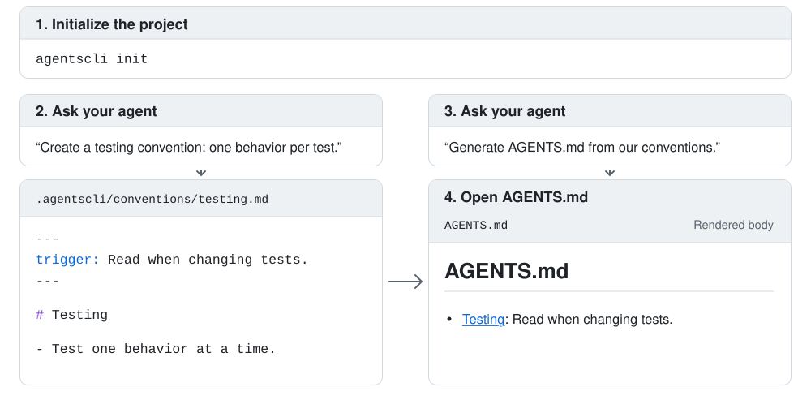

# agentscli

**Project rules in Markdown. A generated index for coding agents.**

[npm package](https://www.npmjs.com/package/@devel-solid/agentscli) · Node.js 22, 24 or 26 · [MIT](https://github.com/devel-solid/agentscli/blob/main/packages/agentscli/LICENSE)

A growing `AGENTS.md` can mix testing rules, API guidelines, and deployment notes in one long document. With agentscli, keep each topic in its own Markdown file. Generate a short `AGENTS.md` with a link to each topic and a sentence explaining when to read it.



In this example, **Testing** links to `.agentscli/conventions/testing.md`. **Read when changing tests.** tells an agent when to consult it. The full rules stay in the convention file.

## Create your first convention and index

The steps below produce the files shown above. You need **Node.js 22, 24, or 26** and npm.

If your project already has a handwritten `AGENTS.md`, read [adopting an existing project](#adopting-an-existing-project) before generating the index. Initialization preserves that file.

### 1. Install the CLI

```sh
npm install --global @devel-solid/agentscli
```

Run the remaining commands from your project root.

### 2. Initialize the project

Preview setup, then install the project skills:

```sh
agentscli init --dry-run
agentscli init
```

`init` creates `.agentscli/conventions/` when needed and installs two skills under `.agents/skills/`. It preserves existing conventions and `AGENTS.md`. You can repeat it to complete setup or refresh recognized resources.

### 3. Write the testing rules

Ask your agent:

> Create a testing convention: one behavior per test.

The agent should create **`.agentscli/conventions/testing.md`** with this content:

```markdown
---
trigger: Read when changing tests.
---

# Testing

- Test one behavior at a time.
```

The `trigger` says when to read the file. The `# Testing` heading supplies its title. Everything below the heading contains your project rules.

### 4. Preview, then generate the index

Ask your agent:

> Generate AGENTS.md from our conventions.

The build skill validates the conventions and generates **`AGENTS.md`** at the project root.

The result is:

```markdown
---
generatedBy: '@devel-solid/agentscli'
---

# AGENTS.md

- [Testing](.agentscli/conventions/testing.md): Read when changing tests.
```

Open `AGENTS.md` and follow the **Testing** link. It should open the convention you created in step 3. The index carries the title and trigger; the rule itself remains in `testing.md`.

**Starting without conventions?** `init` prepares the empty folder and skills. Running the build skill with no conventions generates an index containing only its metadata and title.

## Update the rules as your project changes

Edit your conventions, then regenerate the index with `agentscli-build-agents`. Added conventions get new entries. Deleted conventions disappear from the next index.

For more topics, add files such as `api-errors.md` with the heading `# API errors`. Each convention needs only a nonempty YAML `trigger`, one H1, and its rules. Match the filename to the title, and keep the rules self-contained, without links to other conventions or skills. Subfolders and other content languages are supported.

The [authoring reference](#authoring) covers the complete format and naming rules.

## Let an agent maintain the conventions

Setup installs two skills under `.agents/skills/`. Each skill gives an agent instructions and scripts for a specific task:

| Skill                         | Use it to                                                                       |
| ----------------------------- | ------------------------------------------------------------------------------- |
| `agentscli-write-conventions` | Create, review, or edit convention files                                        |
| `agentscli-build-agents`      | Validate conventions, preview changes, regenerate the index, or check freshness |

For an update, ask your agent:

> Update our testing convention from the current tests, then regenerate AGENTS.md.

For a check without edits:

> Check our conventions and AGENTS.md without changing files.

The installed build skill runs offline using Node.js and versioned project resources. It needs no installed CLI, compiler, Git, or dependency installation.

## Update the installed skills

After upgrading the CLI, refresh the project skills from the version you are running:

```sh
agentscli update --dry-run
agentscli update
```

Both `init` and `update` install the same complete skill resources. They check package resources and safe destinations before writing; convention content and index ownership belong to the build workflow. Neither command validates conventions or generates the index.

An installation exists when at least one product skill has a `SKILL.md` with its matching `name`, `metadata.generatedBy: "@devel-solid/agentscli"`, and a valid semantic `metadata.generatorVersion`. `update` can then restore the other missing skill or entrypoint. Without that evidence, it asks you to run `init`. Initialization accepts missing or empty skill directories; conflicting or unrecognizable content must be preserved elsewhere before retrying. Neither command overwrites a foreign skill entrypoint. `update` does not require or recreate the conventions folder.

## Know which files to edit

| Resource                                     | What agentscli does                             | Where to make your changes                     |
| -------------------------------------------- | ----------------------------------------------- | ---------------------------------------------- |
| `.agentscli/conventions/**/*.md`             | Build validates; setup preserves authored bytes | Edit your rules here                           |
| Root `AGENTS.md`                             | Build skill generates the convention index      | Update its source conventions, then regenerate |
| The two installed product skill directories  | `init` and `update` replace complete contents   | Keep custom rules in conventions               |
| Other skills, unrelated files, and Git state | Preserves them                                  | Continue managing them as usual                |

Installing again removes obsolete files inside the two managed skill directories and replaces local edits there. Commit your conventions, generated index, and both complete installed skills so the project carries its own resources.

### Adopting an existing project

`init` and `update` preserve any existing root `AGENTS.md`. The build skill can replace it only if its frontmatter contains exactly:

```yaml
generatedBy: '@devel-solid/agentscli'
```

Handwritten instructions, another generator's metadata, and invalid metadata block index generation. Move your existing rules into convention files and preserve the original document separately before generating the index.

Validation and collision checks run before writes. Application replaces files individually. If an operational failure interrupts it, inspect the reported completed and pending changes, fix the cause, and rerun the same command.

## Command reference

`init` prepares a project; `update` refreshes an existing installation. Both support the same options, alongside help and version:

```sh
agentscli init
agentscli init --repo-root ./my-project --dry-run
agentscli update --repo-root ./my-project --json
agentscli --help
agentscli --version
```

| Option                    | Meaning                                               |
| ------------------------- | ----------------------------------------------------- |
| `--repo-root <directory>` | Choose the project; defaults to the current directory |
| `--dry-run`               | Preview all planned changes without writing           |
| `--json`                  | Return structured output                              |

See the [offline workflow reference](#offline-agent-workflow) for the build skill's scripts, checks, and exit codes. Releases below `1.0.0` are beta.

## Authoring

The index is sorted by final convention paths. Multiline triggers become one line per entry. The generated frontmatter and title are agentscli's output contract, rather than requirements of the general AGENTS.md format.

Derive each convention's `.md` basename from its H1: normalize with NFKD, remove combining marks, lowercase, and collapse runs other than Unicode letters or numbers to hyphens. Trim outer hyphens and normalize the result to NFC. For example, `日本語` becomes `日本語.md`. Nested directories are allowed. The YAML frontmatter, H1, and body remain in this final authored file. Conventions are self-contained: no links to other conventions, skills, or their support. Trigger links use root AGENTS as their base, and body links use the final convention location. Literal code examples stay literal.

Skills have their own standard description trigger and carry their operation's instructions in their own entrypoint or bundled support. They may mention other skill identities, but must discover their actual project location rather than link or hardcode another resource's path. Own support links are allowed; project files remain legitimate work inputs. Standard string metadata is preserved. Assembly stamps only the two distributed operational skills using the package's actual name and version. Project-owned skills keep their own metadata.

## Offline agent workflow

Ask the installed operational skills to author conventions or build instructions. They remain independent. The build skill owns a self-contained Node engine. Discover its actual directory through project skills, then run its private entrypoint:

```sh
node <build-skill>/scripts/build-agents.mjs validate --repo-root <project> --json
node <build-skill>/scripts/build-agents.mjs sync --repo-root <project> --dry-run --json
node <build-skill>/scripts/build-agents.mjs sync --repo-root <project> --json
node <build-skill>/scripts/build-agents.mjs sync --repo-root <project> --check --json
```

These are skill scripts, not public CLI commands. They use Node and versioned project files with no installed CLI, compiler, Git, or network. Private sync updates only AGENTS.md; validation, previews, and freshness checks write nothing. Authored convention edits change the next index, and authored deletions remove entries without recreating files. Use `init` to prepare or recover setup and `update` to refresh an existing installation. Missing unrelated operational skills do not block a present build engine.

The build skill protects handwritten root instructions. Before replacing an existing AGENTS.md, it requires valid frontmatter containing only `generatedBy: "@devel-solid/agentscli"`. Preserve existing rules in conventions and keep the original document separately before requesting a generated index. With no conventions, generation produces only its frontmatter and title.

Exit codes: 0 success, 1 freshness drift under private `sync --check`, 2 usage/validation/collision, 3 operational failure. JSON has `schemaVersion: 1`, `command`, `ok`, `changes`, and `diagnostics`; changes distinguish pending and completed effects. After partial failure fix its cause and repeat the same authorized operation.

## Links and license

- [Contributing](https://github.com/devel-solid/agentscli#development)
- [npm package](https://www.npmjs.com/package/@devel-solid/agentscli)
- [Report an issue](https://github.com/devel-solid/agentscli/issues)
- [MIT License](https://github.com/devel-solid/agentscli/blob/main/packages/agentscli/LICENSE)
